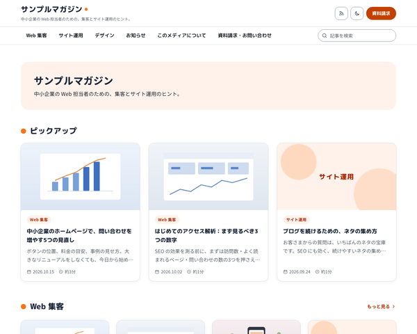

# BcBlogMediaPopTheme

baserCMS5用の、企業がお役立ち記事やコラムを発信する、オウンドメディア（企業のブログ）のためのテーマです。

明るい差し色と丸みのある見出しの、親しみやすい見た目です。カードや箱は角を大きく丸め、トップのカテゴリごとに見出しの印を変えています。



オウンドメディアのテーマは2種類あります。仕組みと機能は同じで、見た目だけが違います。

| テーマ | 見た目 |
|---|---|
| BcBlogMediaBusinessTheme | ビジネス：白地に濃紺。角丸控えめのカード、濃い色の資料請求の帯 |
| BcBlogMediaPopTheme | ポップ：明るい差し色と丸ゴシックの見出し。角の大きく丸いカード、カテゴリごとに違う見出しの印 |

## 主な機能

- トップ：紹介文、ピックアップ（新着3件）、カテゴリごとのまとまり（各カテゴリの新着4件と「もっと見る」）、まとまりの途中の資料請求の帯
- 資料請求の導線
  - ヘッダーの目立つボタン（テーマ設定の「ヘッダーのボタン」で文字とリンク先を変えられる）
  - 帯・箱・バナー：ウィジェットエリア「トップ：CTA」「記事の下：CTA」「広告：一覧の途中」とサイドバーのテキストのウィジェット
  - 資料請求のボタンからフォームを開くと、ご用件の「資料請求」を選んだ状態になる（リンク先の URL に `?purpose=資料請求`）
- 記事の詳細：本文の上の目次（本文の h2・h3 から自動で作る。開閉できる）、読了時間の目安、投稿日・更新日、カテゴリ・タグ、書いた人、シェア、前後の記事、関連記事、コメント
- 一覧：3列のカード（アイキャッチ → 本文の最初の画像 → 「色の枠＋カテゴリ名」の順で表示）、6件目のあとに資料請求の帯、番号つきのページ送り
- サイドバー：資料請求のバナー・カテゴリ（記事数つき）・タグ・最近の投稿（小さなサムネイルつき）。スマホでは本文の下
- 資料請求・お問い合わせのフォーム（入力 → 確認 → 完了）：ご用件・会社名・お名前・メールアドレス・電話番号・内容・同意
- ライト／ダークの切り替え（配色モードと切り替えボタンの有無は、テーマ設定で選べる）
- 本文：BurgerEditor のブロックでも、通常のエディタの HTML でも同じ見た目。見出し3段階、表（スマホでは横にスクロール）、引用、画像とキャプション、補足の囲み（「ポイント」「注意」）
- サイト内検索の結果画面、パンくず（構造化データつき）、印刷用の CSS（本文だけを印刷）
- テーマ設定の4色で配色を変えられる（どの色でも、文字が読める明るさに自動で調整する）
- サブフォルダ（例：`https://example.com/media/`）に設置しても、本文のリンクと画像が切れない

## 動作環境

- baserCMS5.4以上
- BurgerEditor（BcBurgerEditor）：なくても使えます（通常のエディタで書いた本文にも対応）
- 対応ブラウザ：最新の Chrome・Edge・Safari・Firefox（CSS のコンテナクエリ・`:has()`・`color-mix()` を使っています）

## インストール

1. このリポジトリの Releases から ZIP をダウンロードし、管理画面の「テーマ管理」→「新しいテーマを追加」でアップロードする（または `plugins/BcBlogMediaPopTheme/` に置く）
2. 「テーマ管理」で BcBlogMediaPopTheme を適用する
3. 見本のデータを入れるときは、初期データ「default」を読み込む（空の状態から始めるときは「empty」、ページ送りなどを確かめるときは記事が40本入った「test」）

> 初期データを読み込むと、ユーザー以外のデータ（固定ページ・ブログ・ウィジェットなど）は初期化されます。運用中のサイトでは読み込まないでください。

## 使い方

### 編集できる場所

| 内容 | 編集する場所 |
|---|---|
| メディア名 | サイト管理 →「サイトタイトル」 |
| ヘッダーの説明1行・ブログのトップの紹介文 | ブログ設定 →「ブログ説明文」（ヘッダーには最初の1文が出る） |
| トップページの紹介文 | 固定ページ「index」の本文（`<strong>` で囲んだ部分が大きな見出しになる） |
| ヘッダー・フッターのナビ | テーマ設定の「ヘッダーのナビ」で選ぶ。初期値は「ブログのカテゴリ＋固定ページなど」（最初のブログのカテゴリ＋ルート直下の固定ページ・メールフォーム・リンク。「メニューに表示しない」を除く） |
| ヘッダーのボタン（資料請求） | テーマ設定の「ヘッダーのボタン」（文字とリンク先。どちらかを空にすると出ない） |
| ロゴ・配色（4色）・配色モード・切り替えボタン | テーマ設定 |
| 資料請求の帯・箱 | ウィジェットエリア「トップ：CTA」「記事の下：CTA」「広告：一覧の途中」のテキストのウィジェット（「タイトルを表示」はオフ） |
| サイドバー | ウィジェットエリア「サイドバー」（資料請求のバナー・カテゴリ・タグ・最近の投稿） |
| 記事の下の書き手 | ウィジェットエリア「記事の下：著者」 |
| フッターの運営会社・所在地 | ウィジェットエリア「フッター：プロフィール」 |
| プライバシーポリシー | 固定ページ「privacy」（メニューに表示しない） |
| 資料請求・お問い合わせの項目と文面 | メールフォームの設定・メールフィールド |
| 一覧の件数・コメントの受け付け | ブログ設定 |

### 資料請求の帯・箱の書き方

テキストのウィジェットに、次の形で書きます（見出し・短い文・ボタン1つ）。

```html
<div class="bt-cta">
  <div class="bt-cta-text">
    <p class="bt-cta-kicker">無料資料</p>
    <p class="bt-cta-title">Web サイトの見直しチェックリストを無料でお送りします</p>
    <p>問い合わせを増やすための30項目を、PDF にまとめました。</p>
  </div>
  <a class="bt-btn" href="/contact/?purpose=資料請求">資料を請求する</a>
</div>
```

メールフォームへのリンクに `?項目名=値` を付けると、その値を選んだ（入れた）状態でフォームが開きます（項目名はメールフィールドの「フィールド名」）。

### 本文の書き方

- 見出しは h2・h3 を使う（目次に載る）。h4 は目次に載らない
- 補足の囲み：引用（blockquote）の最初の段落を、太字だけの1行にする

```html
<blockquote><p><strong>ポイント</strong></p><p>本文…</p></blockquote>
```

## 設定

### 配色モード

テーマ設定の「配色モード」「ライト／ダークの切り替えボタン」で選べます。テーマ設定を保存していないときは、`config/setting.php` の `colorScheme`（`auto`／`light`／`dark`）と `schemeToggle`（`true`／`false`）が使われます。

### そのほかの設定（`config/setting.php`）

| キー | 初期値 | 内容 |
|---|---|---|
| `topLayout` | `sections` | トップの構成。`list` にすると、新着の一覧と「記事の一覧へ」 |
| `homeSidebar` | `false` | トップページでもサイドバーを出す |
| `listAdAfter` | `6` | 一覧の何件目のあとに「広告：一覧の途中」を出すか |
| `headerCta` | 資料請求 → `/contact/?purpose=資料請求` | ヘッダーのボタンの初期値（テーマ設定の値が優先） |
| `toc` / `tocOpen` | `true` / `true` | 本文の上の目次を出す／開いた状態で出す |
| `recentThumb` | `true` | 最近の投稿に小さなサムネイルを付ける |
| `dateFormat` | `Y.m.d` | カード・記事の日付の書式（PHP の date の書式） |

### ウィジェットエリアを自分のサイトに足すとき

初期データを使わずにテーマだけを適用したときは、ウィジェットエリアを「トップ：CTA」「記事の下：CTA」「記事の下：著者」「フッター：プロフィール」「広告：記事の上」「広告：記事の下」「広告：一覧の途中」の名前で作ると、その場所に表示されます（名前で探しています）。

## 制限事項

- アイキャッチの見本画像は、初期データでは入りません（baserCMS の初期データは画像ファイルをコピーしないため）。見本の記事は、本文の最初の画像をカードに使っています
- カテゴリの説明文は表示しません（baserCMS5 のブログのカテゴリに説明文の項目がないため）
- 閲覧数のランキングはありません（baserCMS に閲覧数のデータがないため）
- 書いた人の肩書きは、記事の下の書き手（ウィジェット）に書きます。記事の上には、ユーザーのニックネームだけが出ます
- 初期データを読み込むと、記事の投稿日は見本の日付に戻ります（BcBlog は読み込み時にすべての投稿日を「今」にするため、テーマで戻しています）
- サイト内検索の索引は、初期データに同梱しています。記事を追加・編集すると、索引は自動で更新されます

## 同梱物・外部リソース

| 名前 | 用途 | ライセンス |
|---|---|---|
| [jQuery](https://jquery.com/) 3.7.1（`webroot/js/vendor/`） | BurgerEditor の公開側スクリプトと、ブログのコメントの送信に必要 | MIT |
| [Google Fonts](https://fonts.google.com/)（M PLUS Rounded 1c・Noto Sans JP） | 見出し・本文のフォント（CDN から読み込み。同梱はしていない） | SIL Open Font License 1.1 |
| アイコン（`templates/element/icons.php` の SVG） | ヘッダー・シェア・日付などのアイコン | このテーマの一部（MIT） |
| 見本画像（`webroot/img/sample/`） | 見本の記事・書き手の画像（文字を含まない図だけの画像） | このテーマの一部（MIT） |

## ライセンス

MIT License（[LICENSE](LICENSE)）
